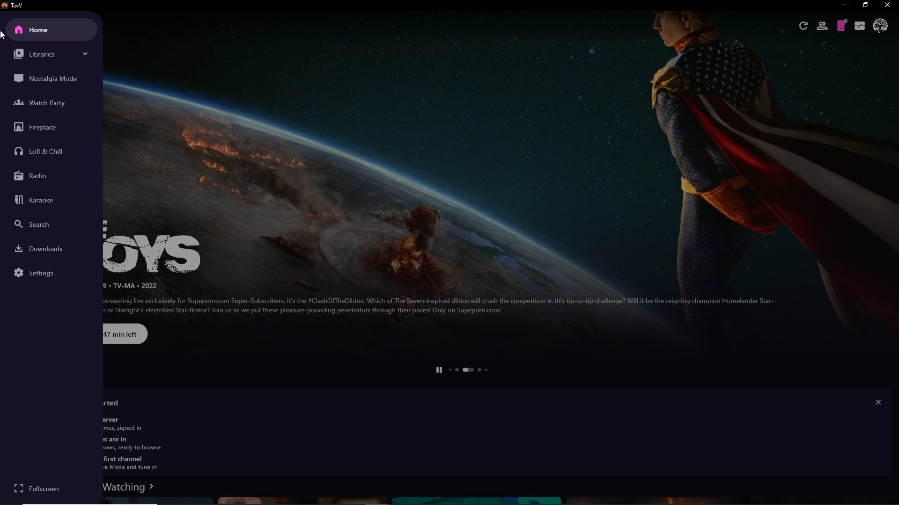
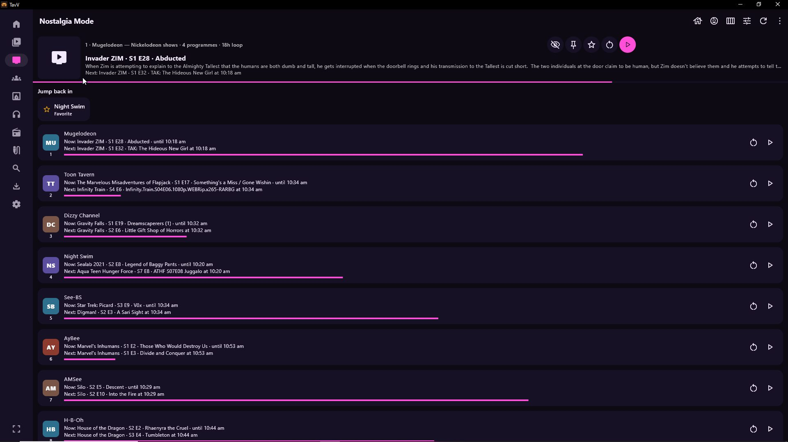
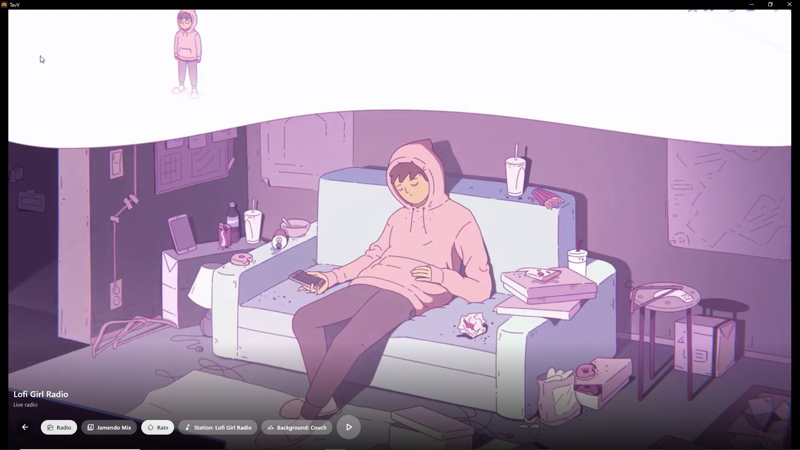
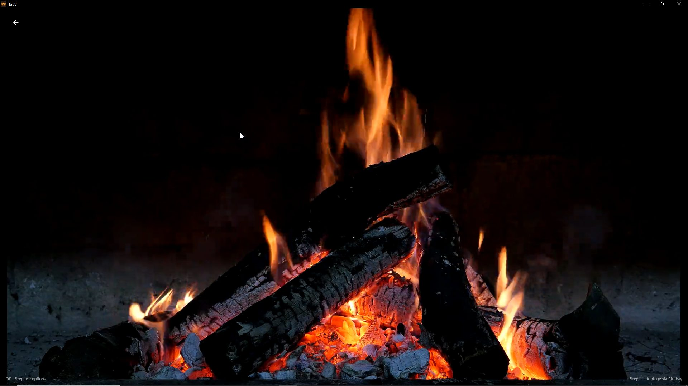
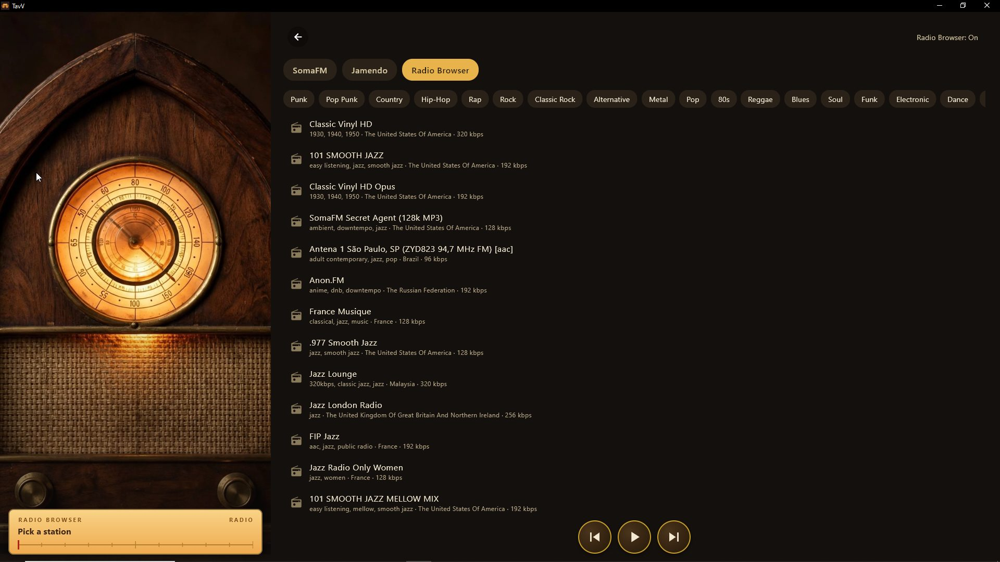

# TavV

**Your Plex library, with a few extras.**

TavV is a fork of the [Plezy](https://github.com/edde746/plezy) Plex client — full Plex browsing and playback, plus a layer of extras Plezy doesn't have. Sign in with your Plex account, point it at your server, and everything below is just there, in the app.

**Platforms:** Android TV · Google TV · Fire TV · Windows (TavV Desktop)

📥 **[Download the latest release](https://github.com/Tr33oflife/tavv-releases/releases/latest)** · [All releases](https://github.com/Tr33oflife/tavv-releases/releases) · [Changelog](#changelog)

*The home screen. Everything TavV adds lives in the sidebar: Nostalgia Mode, Watch Party, Fireplace, Lofi & Chill, Radio, Karaoke — alongside the full Plex library.*

---

## What you need

- A **Plex account** and access to a **Plex server** with your movies, shows and music. TavV is a player for your library — it doesn't host anything itself.
- The TV builds install like any sideloaded APK; the Windows build is a plain ZIP — unzip and run `tavv.exe`.
- TavV **updates itself**: the in-app updater checks this repo, so once you're installed, new builds arrive in the app.

## What TavV adds

On top of everything Plezy already does well:

### 📺 Nostalgia Mode — live-TV channels from your own library

Custom live-TV-style channels built from your Plex library, with a real channel guide: numbered channels, Now/Next listings, channel surfing with the remote (channel up/down keys zap like a real TV). Build channels with the channel wizard, shape them with dayparts, and define them by **Plex labels** — include only items carrying a label, or ban labels outright.

Channels behave like real cable, too:

- **Episode cooldown** — the same episode can't repeat on the same channel for at least 48 hours (a week where the pool allows), just like regular TV.
- **The fit check** — a quiet background pass that checks whether a title actually belongs on its channel, using outside facts (OMDb) and an optional AI tone pass, and drops the misfits.
- **Sign-off hours** — thin channels sign off overnight (2–6 AM) instead of threadbare repeats; empty channels hide from the guide, leaving gaps in the numbering like real cable.
- **Listing sync** — every TV in the house shares one lineup. The first set of the day starts the household; the others hear it and join on their own.

*The guide: your channels, numbered and always in the same place, each with what's on now and what's next.*

### 🎧 Lofi & Chill

A listening panel that looks as good as it sounds: lofi radio stations and Jamendo mixes over animated scenes — 3 bundled backgrounds that work offline, plus downloadable lofi loops — with an optional rain layer on top. Pick a station, pick a background, leave it on.

*Lofi Girl Radio over the Couch scene. Station, Jamendo mix, rain and background are all one tap apart.*

### 🔥 Fireplace

Fireplace scenes made to be left on — bundled scenes plus downloadable ones (Brick Hearth, Fire Pit, Ember Stove download on first pick and play from the device after that), with their own quiet radio: seven SomaFM stations in fireplace themes.

*The Fireplace, full screen. Scenes are real looping footage, not a still picture.*

### 📻 Radio

A standalone radio panel wearing a 1930s cathedral-radio skin — walnut cabinet, a working amber dial, preset push-buttons. Three bands:

- **46 SomaFM stations**, tuned from the panel, with held-OK preset pins (up to 8, they survive restarts)
- **6 Jamendo mixes** — jazz, lounge, chillout, classical, ambient, christmas
- **Radio Browser** (optional, off by default) — **28 genre shelves** from punk and country to hip-hop, talk and comedy, plus search

*The Radio panel: cathedral cabinet on the left, the Radio Browser's genre shelves and station list on the right.*

### 🎤 Karaoke

Pick a track from your Plex/Jellyfin music library and sing along — line-synced lyrics from LRCLIB light up line by line as the track plays, right in the panel. Unsynced or missing lyrics are labelled honestly. The original vocal stays in; it's a sing-along, not a vocal remover.

### 🥂 House Party & Guest Pass

Watch-together for the household: start a House Party from the player or the guide and other sets in the house can see what's on and follow along. **Guest Pass** (build 1255) turns the household invite into a deliberate thing — send the invite text to someone and they're in the household from anywhere; "Forget this household" on your side re-mints the key and revokes it.

### 🗝️ Cheat codes

Settings → Services → Cheat codes accepts plain phrases that wake hidden panels:

- `secret stash` — the **Stash** library panel
- `ask the bartender` — the **Requests** panel
- `librarian` — the **Books** tab
- `game night` — the **Games** entry

(The original letter codes still work too.)

### 🖥️ TavV Desktop

The same TavV, same features, built for Windows. Everything above runs on the desktop with full keyboard and mouse control — since build 1262 every panel is clickable, with press-and-hold doing the long-press, exactly like the remote.

### 🎨 Everything free

No supporter pack, no purchase gates: every theme (including Ember, Glacier, Forest, Plum, Paper and the custom palette editor) and every alternate app icon is simply available in every build. The only gates left are Plex Pass for Plex's own features, and the cheat codes above.

---

## Downloads

Grab the newest build from the **[Releases page](https://github.com/Tr33oflife/tavv-releases/releases)**. Each release carries up to three files:

| File | For |
|---|---|
| `TavV-<version>-<build>-armeabi-v7a.apk` | Most streamer TVs: Chromecast with Google TV, Fire TV Sticks, onn boxes, Shield (tube) |
| `TavV-<version>-<build>-arm64-v8a.apk` | 64-bit TVs: Shield Pro (2015–2019), Fire TV Cube gen 2, newer Sony/TCL |
| `TavV-<version>-<build>-windows-x64.zip` | Windows desktop (build 1260 and later) — unzip, run `tavv.exe` |

Install the APK with TV Toolbox or any APK installer. All releases are signed with one consistent key, so a newer file installs over an older TavV without removing it first — and once installed, the in-app updater keeps you current from this repo.

> One extra release, **fireplace-loops-v1**, isn't an app update: it carries the downloadable Fireplace scenes for build 1250+. The app fetches them itself on first pick; you don't need to download them by hand.

---

## Changelog

Full notes live on each [release](https://github.com/Tr33oflife/tavv-releases/releases); the headlines:

### Build 1262 — Karaoke + mouse fix · [notes](https://github.com/Tr33oflife/tavv-releases/releases/tag/v2.26.0-1262)

- **Karaoke (1261):** a new panel in the music family — pick a track from your Plex/Jellyfin music library and sing along to LRCLIB line-synced lyrics in-panel. Unsynced or missing lyrics are labelled honestly.
- **Mouse fix (1262):** clicks now work on every TavV panel (Fireplace, Lofi, Radio, Karaoke, guide cards) — a tap focuses and selects, press-and-hold does the long-press. Keyboard/D-pad behaviour unchanged.
- Windows bundle included.

### Build 1260 — Label channels, Radio Browser in full, first Windows bundle · [notes](https://github.com/Tr33oflife/tavv-releases/releases/tag/v2.26.0-1260)

- **Plex/Jellyfin labels drive custom channels (1259):** a channel can include only items carrying chosen labels and/or ban labels outright (ban wins), picked in the channel wizard from a live scan of your libraries' labels.
- **Radio Browser goes full:** 28 genre shelves — punk, pop-punk, country, hip-hop and rap lead, then rock, classic rock, alternative, metal, pop, 80s, reggae, blues, soul, funk, electronic, dance, latin, talk, comedy, sports, and the mood set.
- **First Windows bundle** — TavV Desktop ships as a ZIP alongside the APKs. (Its mouse issue on the added panels was fixed in 1262.)

### Build 1258 — The Radio panel · [notes](https://github.com/Tr33oflife/tavv-releases/releases/tag/v2.26.0-1258)

- **Radio panel (1257):** 46 SomaFM stations with remote tuning and held-OK presets (up to 8), 6 Jamendo mixes, and an optional Radio Browser band — off by default; while off it renders nothing and makes no requests.
- **The skin (1258):** the panel wears a 1930s cathedral radio — walnut cabinet, a working amber dial whose needle tracks the current stop on its band, preset push-buttons, knob transport.
- Fireplace radio grew by 4 stations (Illinois Street Lounge, Bossa Beyond, Left Coast 70s, Xmas in Frisko — 7 total).

### Build 1256 — House Party chip fix, first Windows source · [notes](https://github.com/Tr33oflife/tavv-releases/releases/tag/v2.26.0-1256)

- The House Party entry chip no longer renders over Nostalgia channels; it remains library playback's way in, and TV sessions use the guide panel's House Party row.
- Same source as the first Windows build (TavV identity + the video-rect fix for the Lofi/Fireplace small-square bug on Windows). Both ABIs ship.

### Build 1255 — Guest Pass · [notes](https://github.com/Tr33oflife/tavv-releases/releases/tag/v2.26.0-1255)

- **Guest Pass:** the listing-sync dialog gains an invite surface — the household's invite text, an "Accept an invite code" field, and provenance for invited households. "Forget this household" re-mints the key and revokes every pass.
- **Back-key fix:** Lofi & Chill and the Fireplace can now be left with a companion remote's Back button.
- **Up Next labels:** banners and the guide now read "Show · S# E# · Episode title" (movies stay plain title).

### Earlier builds

- **1249** — Lofi & Chill performance pass: bundled scenes re-encoded lighter (720p24) for 32-bit hardware.
- **1248** — Lofi & Chill black-background fix: the panel's music and rain move to a dedicated audio player so the scene player always paints.
- **1247** — Upstream Plezy 2.26.0 sync (Dolby Vision, subtitle and seek fixes); **everything free** — the Supporter pack removed; Smart Shuffle button in the library header; remote channel up/down keys zap channels in the player.
- **1246** — The cable pack: **sign-off hours**, **dead channels hidden**, **cheat phrases** (`secret stash`, `ask the bartender`, `librarian`); Explore/Jump tabs off by default on fresh installs. Carries 1245: crash reporting stripped out entirely, and the episode-cooldown ledger syncs through the household relay.
- **1244** — **The episode cooldown:** no episode repeats on the same channel within 48 hours minimum, 7-day target, clocked on scheduled airtime.
- **1243** — Lofi background picker: 17 animated backgrounds (3 bundled, 14 downloadable); commentary tracks can no longer be auto-selected or carried onto the next episode.
- **1242** — Lofi scenes fix: the room artwork no longer covers the playing scene.
- **1241** — Fit check gains a high-accuracy AI mode; **listing sync sets itself up** (on by default, households self-join); the guide menu reopens where you left it; Lofi gains real looping video scenes.
- **1240 / 1239** — **The fit check** arrives: OMDb facts drop anime and genre misfits from channels; an optional AI tone pass joins it.
- **1238 – 1236** — A streaming-channels experiment (Pluto and friends) that came and went across three builds; the guide keeps the compact header it produced.
- **1235** — Channel rebuild: guide hardened so a broken channel renders as a named dead row instead of a black screen; schedule export as JSON; channel rule fixes.

---

## About this repo

This repo carries **release files only — no source code**. TavV is a fork of [Plezy](https://github.com/edde746/plezy); upstream's playback fixes flow in through syncs like build 1247's move to Plezy 2.26.0. Fireplace footage via Pixabay.
